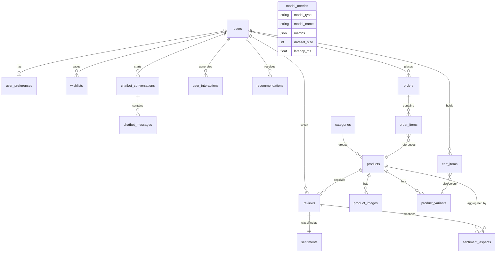

# RecoSense AI

**AI-Powered E-Commerce Recommendation System Using Sentiment Analysis**
*Shop Smarter. Choose Better. Powered by AI.*

RecoSense AI is a full-stack fashion e-commerce platform. It analyses real customer reviews with NLP,
extracts aspect-level opinions (fit, fabric, comfort…), and blends content-based, collaborative and
sentiment signals into explainable hybrid recommendations. It also includes a retrieval-based shopping
assistant, product comparison, review summaries, and admin analytics with a model-evaluation dashboard.

| Layer | Stack |
|---|---|
| Frontend | Next.js 16 (App Router) · TypeScript · Tailwind CSS 4 · shadcn-style UI on Radix · TanStack Query · Recharts · React Hook Form + Zod · lucide-react · next-themes |
| Backend | FastAPI · Pydantic v2 · SQLAlchemy 2 · Alembic · JWT (PyJWT) · bcrypt |
| Database | PostgreSQL 16 (18 tables) |
| AI / ML | scikit-learn (TF-IDF, Logistic Regression, Complement NB, cosine similarity, item-KNN) · NLTK (tokeniser, Snowball stemmer) · pandas / NumPy |
| Testing | Pytest + HTTPX (FastAPI TestClient) against a real PostgreSQL test database |
| Deploy | Vercel (frontend) · Render / Railway (API + PostgreSQL) · Docker Compose |

> **About the data.** Products and brands are fictional **sample data** with generated illustrations.
> Reviews are **real**: 2,109 reviews from the public *Women's E-Commerce Clothing Reviews* dataset
> (CC0), taken only from the model's held-out test split and linked to sample products by garment class.
> Demo shopper interactions (views, wishlist, cart, purchases) are **synthetic** and flagged `is_demo`.
> No demo orders are created. Checkout is a demo: no payments are taken.

---

## 1. Architecture

```mermaid
flowchart LR
  subgraph Browser
    UI[Next.js App Router<br/>TanStack Query]
  end
  UI -- REST + JWT --> API[FastAPI]
  UI -. proxy.ts optimistic route guard .-> UI
  API --> SVC[Services<br/>cart · orders · chatbot · comparison · import]
  SVC --> DB[(PostgreSQL)]
  API --> ML
  subgraph ML[ML layer - local, no paid APIs]
    S[Sentiment<br/>TF-IDF + LogReg]
    A[Aspect extraction<br/>clauses + lexicon]
    R[Hybrid recommender<br/>content · item-KNN · sentiment · rating]
    Z[Extractive summariser]
  end
  ML --> DB
  S -. joblib .- M[(trained_models/)]
```

### ER diagram



All tables have primary keys, foreign keys with `ON DELETE` rules, indexes, unique constraints
(e.g. `uq_review_user_product`, `uq_cart_user_product_variant`), check constraints (price ≥ 0,
rating 1–5, discount ≤ 90%) and `created_at` / `updated_at` timestamps. Schema: `backend/alembic/versions/0001_initial_schema.py`.

---

## 2. Run it locally

**Prerequisites:** Python 3.12+ (tested on 3.13), Node.js 20+ (tested on 22), PostgreSQL 14+ (tested on 16).

### 2.1 Database (one-time)

```bash
psql -U postgres -c "CREATE USER recosense WITH PASSWORD 'recosense' CREATEDB;"
psql -U postgres -c "CREATE DATABASE recosense OWNER recosense;"
psql -U postgres -c "CREATE DATABASE recosense_test OWNER recosense;"   # used by the test suite
```

### 2.2 Backend (terminal 1)

```bash
cd backend
python -m venv .venv
# Windows: .venv\Scripts\activate      macOS/Linux: source .venv/bin/activate
pip install -r requirements.txt
cp .env.example .env                    # Windows: copy .env.example .env  — then set JWT_SECRET_KEY
alembic upgrade head                    # creates all 18 tables
python -m app.seed.run                  # sample catalogue + real reviews + demo users (~10 s)
uvicorn app.main:app --reload --port 8000
```

The trained models are already in `backend/trained_models/`. To retrain from scratch, run
`python -m app.ml.sentiment.train` (about 50 s with hyper-parameter search, or add `--quick`).
`python -m app.seed.run --reset` wipes and re-seeds the database.

API docs (Swagger UI): **http://localhost:8000/docs** · Health: http://localhost:8000/api/health

### 2.3 Frontend (terminal 2)

```bash
cd frontend
npm install
cp .env.example .env.local              # NEXT_PUBLIC_API_URL=http://localhost:8000
npm run dev                             # http://localhost:3000
```

### 2.4 Or use Docker

```bash
docker compose up --build               # db + api (auto-migrates & seeds) + web
```

### Demo accounts (sample data)

| Role | Email | Password |
|---|---|---|
| Admin | `admin@recosense.ai` | `Admin@1234` |
| Customer | `demo@recosense.ai` | `Demo@1234` |
| 60 synthetic shoppers | `shopper01…60@demo.recosense.ai` | `Shopper@1234` |

The login page has one-click buttons that fill in the demo accounts.

---

## 3. How to verify each feature

| Feature | How to check |
|---|---|
| Auth & RBAC | Register at `/register` (password strength + Zod validation). Sign out, then open `/cart` and you're redirected to `/login?next=/cart`. Log in as the customer and open `/admin/dashboard`: you're sent to `/home`. The API returns 403 for customers on `/api/admin/*`. |
| Forgot password | `/forgot-password` → in development the reset link is shown (no email service) → set a new password. The link works once only. |
| Catalogue, search & filters | `/products`: category, brand, price slider, rating, **positive-sentiment %**, in-stock and sort (popularity / relevance / sentiment / rating / price / newest). Filters stay in the URL. The header search box autocompletes products, brands and categories. |
| Product page | `/products/1`: size selection (sold-out sizes are disabled), quantity, add to cart, wishlist, compare. Tabs for **AI summary**, **Sentiment insights** (distribution, aspects, trend) and **Reviews** (filter by sentiment). |
| Write a review | Signed in, open a product → *Write a review*. The toast shows the model's label, and the aspect chips and product sentiment update immediately. |
| Cart / checkout / orders | Add items, change quantities, and see the subtotal, discount, shipping (free over ₹1,999) and total. Unavailable items block checkout. `/checkout` validates the form → `/orders` shows the order with a status tracker; you can cancel it (stock is restored). |
| Wishlist & recently viewed | The heart icon on any card saves to the database. `/home` shows *Recently viewed* from tracked product views. |
| Recommendations | `/recommendations`: switch Hybrid / Content / Collaborative / Sentiment, tick *Show score breakdown*, and click *Refresh*. Every card has a reason. A newly registered user gets the **cold-start** banner, and setting preferences changes the results. |
| Similar products | Bottom of any product page (content similarity + sentiment, with reasons). |
| Sentiment analysis | `/sentiment-analysis`: paste a review (Example 1 is the spec's dress review → **Mixed**, + Design & style, + Fabric quality, − Fit & sizing). The explorer shows per-product aggregates. |
| AI assistant | `/ai-assistant`: try the starter prompts. Follow up with “compare these two”. History is saved per user. |
| Comparison | Add 2–4 products with the compare icon → `/compare`: price, rating, sentiment, fabric/comfort/fit sentiment, AI pros and cons, and a best-for summary. |
| Admin dashboard | `/admin/dashboard`: KPIs, sentiment donut, categories, most-recommended products, recent orders, all live from the database. |
| Admin analytics | `/admin/analytics`: sentiment trend, review volume, category popularity, interactions, recommendation activity, aspects, product performance, sentiment report. |
| Admin CRUD | `/admin/products` (search, edit, delete, manage categories) · `/admin/products/create` · `/admin/reviews` (hide, restore, delete, which recomputes aggregates) · `/admin/users` (role, activate). |
| Recommendation config | `/admin/recommendations`: weight sliders (saved and normalised), *Rebuild models*, preview any user's recommendations. |
| Model evaluation | `/admin/model-performance`: accuracy, precision, recall, F1, confusion matrix, classification report, LR vs NB, P@K / R@K / NDCG@K / coverage, *Retrain all* (background job with live status), CSV upload with a validation report. |
| Dark mode / responsive | Moon icon in the header. Resize to mobile to get the drawer menu, the filters sheet and stacked layouts. |

---

## 4. Machine learning, with real results

### Sentiment classification
* **Data:** 22,636 de-duplicated reviews (title + text). Labels come from the rating: 4–5 positive, 3 neutral, 1–2 negative.
* **Preprocessing:** HTML/URL removal, lower-casing, contraction expansion, repeated-character squashing,
  NLTK regexp tokenisation, Snowball stemming, stop-word removal that **keeps negations and intensifiers**,
  and negation scope marking (`not fit` → `NOT_fit`).
* **Features:** TF-IDF on word 1–2-grams (`sublinear_tf`, `min_df=2`, up to 80k features).
* **Models:** Logistic Regression (`class_weight=balanced`, C chosen by 3-fold grid search on macro-F1) vs Complement Naive Bayes.
* **Held-out test set (4,528 reviews, stratified 80/20, `random_state=42`):**

| Model | Accuracy | Macro-F1 | F1 neg / neu / pos |
|---|---|---|---|
| **TF-IDF + Logistic Regression** (production) | 82.1% | **0.667** | 0.61 / 0.47 / 0.92 |
| TF-IDF + Complement NB | 83.3% | 0.591 | 0.57 / 0.28 / 0.93 |

NB has slightly higher accuracy only because the data is 78% positive. LR is chosen because it is much
better on the minority classes. Neutral (3★) reviews are the hardest class, as expected. DistilBERT
was **not** trained in this build and is shown as *pending* on the dashboard.

### Aspect-based sentiment
Reviews are split into sentences, then into clauses at contrast words (*but, however, although…*).
Eight aspects are detected with a fashion lexicon: fabric quality, fit & sizing, comfort, design &
style, colour, length, value for money, and durability. Each clause is scored as
0.6 × (model P(pos) − P(neg)) + 0.4 × a negation-aware opinion lexicon. A review is marked **Mixed**
when it contains both clearly positive and clearly negative aspects. All predictions are stored in
`sentiments` and `sentiment_aspects`, and every analytic is aggregated from these tables.

### Hybrid recommender
`score = w_c·content + w_cf·collaborative + w_s·sentiment + w_r·rating`. Each component is min-max
normalised to 0–1 over the candidates. Default weights are 0.35 / 0.30 / 0.25 / 0.10, configurable in the admin panel.
* **Content:** TF-IDF over name, category, brand, material, colour, tags, description and price band, plus log-price similarity; cosine similarity to the user's weighted interaction profile, blended with stated preferences.
* **Collaborative:** implicit user–item matrix (view 1, click 1.5, wishlist/cart 3, purchase 5, ratings ±) → item-item cosine similarity with top-20 neighbours (item-KNN, chosen over matrix factorisation for a catalogue of this size).
* **Sentiment:** smoothed mean review score. **Rating:** Bayesian average shrunk toward the catalogue mean.
* **Cold start:** new users get preferences + trending + sentiment; new products are reached through content features.

**Offline evaluation** (leave-latest-25%-out on 56 users, K = 10):

| Strategy | Precision@10 | Recall@10 | NDCG@10 |
|---|---|---|---|
| Popularity baseline | 0.068 | 0.402 | 0.217 |
| Sentiment-only | 0.055 | 0.330 | 0.205 |
| Content-based | 0.163 | 0.964 | 0.802 |
| **Collaborative (item-KNN)** | **0.164** | **0.982** | **0.826** |
| Hybrid (weighted) | 0.163 | 0.964 | 0.816 |

⚠️ These interactions are **synthetic**: they were generated from personas with strong category
preferences, so recall is inflated. On this data the hybrid does **not** beat item-KNN, and the
dashboard says so. Treat these numbers as a check that the pipeline works, not as evidence of
real-world performance.

### AI shopping assistant
A rule-based NLP parser extracts the intent (search, best reviewed, complaints, compare, similar to
wishlist, personal), category, price range (*under ₹2,000*, *between 1k and 2.5k*), brand, colour,
aspects and keywords. It then queries PostgreSQL with those filters and ranks the results using the stored
sentiment and aspect statistics. Every product comes with data-backed reasons. If nothing matches,
filters are relaxed step by step and the reply says so. No LLM API is used.

### Review summarisation
Extractive: the top praised and criticised aspects come from aggregated aspect sentiment. For each
aspect, the most central customer clause (by mean TF-IDF cosine similarity) is quoted verbatim.
Products with fewer than 3 reviews get a fallback message. Summaries are labelled *AI-generated*;
quotes are labelled as customer words.

---

## 5. API overview

Full interactive docs are at `/docs`. Main routes:

```
POST /api/auth/register | /login | /forgot-password | /reset-password      GET|PUT /api/auth/me, /preferences
GET  /api/products (filters, sort, pagination) | /products/{id} | /products/suggest | /products/facets
POST|PUT|DELETE /api/products[/{id}]  (admin)            GET|POST|PUT|DELETE /api/categories
GET|POST /api/products/{id}/reviews   GET /api/products/{id}/sentiment   GET /api/products/{id}/summary
POST /api/sentiment/analyze           GET /api/reviews/featured
GET  /api/recommendations/{user_id}?algorithm=   GET /api/recommendations/similar/{id}   POST /api/recommendations/refresh
GET|POST|DELETE /api/wishlist         GET|POST|PUT|DELETE /api/cart       POST|GET /api/orders, GET /api/orders/{id}
POST /api/interactions  GET /api/interactions/recent     GET /api/compare?ids=1,2,3
POST /api/chatbot/message             GET /api/chatbot/history
GET  /api/admin/dashboard | /analytics | /sentiment-report | /model-metrics | /users | /reviews | /recommendations
POST /api/admin/dataset/upload | /models/train (background job) | /recommendations/rebuild   PUT /api/admin/recommendations/config
```

---

## 6. Security

bcrypt password hashing (12 rounds) · JWT access tokens with expiry · role checks on every admin
endpoint · Pydantic validation on all inputs · ORM-only queries (no SQL string building) · CORS
allow-list from the environment · per-IP rate limiting (stricter on auth routes) · CSV upload checks
(extension, content type, size limit, binary sniffing, required columns, row cap) · password-reset
tokens expire and work once · secrets only in `.env` (examples in `.env.example`) · password hashes
are never serialised · request logging.

The Next.js `proxy.ts` only does an *optimistic* redirect; the API is the authority.

---

## 7. Tests

```bash
cd backend && source .venv/bin/activate
pytest -q          # 29 tests, ~20 s, uses the recosense_test database
```

The tests cover hashing, register/login/validation, password reset, RBAC, product filters, sorting
and CRUD, wishlist, cart totals, unavailable-item handling, checkout and stock changes, order privacy,
preferences, preprocessing, aspect extraction, the spec's mixed-review example, review → stored
sentiment → aggregates, CSV import (missing values, invalid ratings, in-file and existing
duplicates, bad file types), the chatbot parser and retrieval with follow-up compare, cold-start →
personalised recommendations, similar products, comparison, and evaluation metric ranges.

Frontend checks: `npm run typecheck` · `npm run lint` · `npm run build`.

---

## 8. Deployment

1. **Database + API on Render:** push to GitHub → *New → Blueprint* → select the repo (uses `render.yaml`).
   Set `CORS_ORIGINS` and `FRONTEND_URL` to your Vercel URL. `scripts/start.sh` migrates, seeds on first boot, and starts uvicorn.
   *Railway:* create a PostgreSQL service and a service with root `backend`, start command `sh scripts/start.sh`, and the same environment variables.
2. **Frontend on Vercel:** import the repo, set the root directory to `frontend`, and add the environment variable
   `NEXT_PUBLIC_API_URL=https://<your-api>.onrender.com`.

---

## 9. Project structure

```
backend/
  app/
    main.py                  FastAPI app, middleware, error handlers
    api/routes/              auth, products, reviews, commerce, recommendations, assistant, admin
    core/                    config, security (JWT/bcrypt), rate limiting
    models/                  18 SQLAlchemy models        schemas/   Pydantic request/response models
    repositories/            product query helpers        services/  cart/orders, chatbot, comparison, import, jobs
    ml/sentiment/            preprocess, aspects, train, predictor
    ml/recommendation/       engine (hybrid), evaluation
    ml/summarization/        extractive summariser
    seed/                    sample catalogue, illustration generator, seed runner
  alembic/  datasets/  trained_models/  tests/  scripts/start.sh  Dockerfile
frontend/
  app/(auth)/                login, register, forgot-password
  app/(customer)/            landing, products, products/[id], compare, sentiment-analysis
  app/(customer)/(account)/  home, recommendations, ai-assistant, wishlist, cart, checkout, orders, profile
  app/admin/                 dashboard, analytics, products, products/create, reviews, users, recommendations, model-performance
  components/                ui, layout, products, sentiment, recommendations, charts, home, admin, commerce
  hooks/  lib/  services/  types/  public/images/products/  proxy.ts
```

## 10. Known limitations

* Product photos are generated illustrations; admins can set real image URLs.
* Recommendation metrics come from synthetic interactions (see §4).
* Dataset reviews have no timestamps, so trend charts use import-assigned dates.
* Password-reset emails are not sent (no mail provider); the link is shown in development only.
* Rate limiting and training jobs are in-process (single instance). Use Redis or a task queue to scale out.
